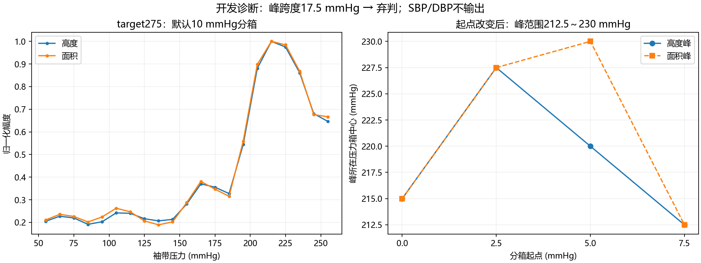

# 通用包络提取与分箱稳定性检查（2026-11-05）

本轮完成离线提取统一和稳定性弃判；尚不适合移植、烧录为通用固件。没有串口写入、充放气、校准或固件操作。

关键发现：最新 target275 的默认分箱峰为215 mmHg；四种分箱起点下，高度/面积峰覆盖212.5～230 mmHg，跨度17.5 mmHg，超过本轮预先声明的15 mmHg敏感性上限，因此正式包络候选弃判。该跨度不是血压误差或置信区间。

## 修改内容

- `bp_standard_envelope.py` 成为共同提取实现：原始电压带通、脉率检查、谷到谷逐搏、压力阶跃排除、逐搏高度/面积、未舍入分箱和尾部检查。
- 不再把有效压力范围内的多个时间片拼接做Welch。选择最长连续时段，要求至少600点、50 mmHg跨度；整搏必须位于该时段内。末端20 mmHg附近的反复越界样本明确记录为舍弃。
- 采用固定10 mmHg箱宽，起点分别0、2.5、5、7.5 mmHg。每种均须通过既有支撑/双尾/高度面积一致性检查；所有高度与面积峰的跨度须≤15 mmHg。不能从中挑最接近面板的结果。
- 增加相距至少30 mmHg且高度达到主峰90%的竞争局部峰弃判；无脉搏、未算完、时钟异常均在诊断中显示真实失败。
- 推断只读取calc状态、原始压力/电压和MCU时间；预设、面板血压、固件MAP与导出包络均不作为输入。SBP/DBP保持null。

## 已有真实数据

13次历史尝试全部保留：8份完整导出、5次历史失败。完整数据涉及120/80、150/100、200/150、255/195四档；不是七档均已完成实测。

| 轮次 | 面板设置 | 旧离线峰 | 新结果 | 四起点峰跨度 | 原因 |
| --- | --- | ---: | --- | ---: | --- |
| standard120_80_20261101-111311 | 120/80 | 95.0 | 95.0 mmHg候选 | 7.5 | 稳定性检查通过 |
| standard120_80_20261101-114844 | 120/80 | 95.0 | 95.0 mmHg候选 | 7.5 | 稳定性检查通过 |
| standard120_80_20261101-120429 | 120/80 | 100.0 | 100.0 mmHg候选 | 10.0 | 稳定性检查通过 |
| standard120_80_20261101-152030 | 120/80 | 95.0 | 95.0 mmHg候选 | 7.5 | 稳定性检查通过 |
| standard150_100_20261101-123247 | 150/100 | 125.0 | 125.0 mmHg候选 | 7.5 | 稳定性检查通过 |
| standard200_150_20261101-134453 | 200/150 | 弃判 | 弃判 | 17.5 | incomplete_or_weak_peak |
| standard255_195_20261105-103250 | 255/195 | 弃判 | 弃判 | 7.5 | incomplete_or_weak_peak |
| standard255_195_target275_capacity4200_20261105-111540 | 255/195 | 215.0 | 弃判 | 17.5 | bin_origin_peak_unstable |

5份候选均为120/80或150/100的开发数据，不能证明复现精度。150/100仍保留125 mmHg候选（面板MAP116，差+9 mmHg），没有硬减9去凑数。

最新target275各起点的高度/面积峰：

| 起点(mmHg) | 高度峰(mmHg) | 面积峰(mmHg) |
| ---: | ---: | ---: |
| 0.0 | 215.0 | 215.0 |
| 2.5 | 227.5 | 227.5 |
| 5.0 | 220.0 | 230.0 |
| 7.5 | 212.5 | 212.5 |



## 验证与复现

全部146项测试通过，包含实际生产C的主机回归；本轮新增8项测试覆盖不完整计算、异常tick、时间片碎裂、末端越界、阀阶跃、双峰、标签独立性、诊断一致性及target275真实回归。合成压力/脉率范围测试继续通过；60/30低压档仍按低侧覆盖不足弃判。测试不是独立准确度评估。

在仓库根目录运行（依赖既有numpy/scipy环境）：

```powershell
python "blood pressure monitor/tools/bp_standard_adaptive.py" --manifest "data/reports/standard_bp_envelope_stability_20261105.manifest.json" --output "tmp/standard_stability_reproduced.adaptive.json"
python "blood pressure monitor/tools/bp_standard_diagnostics.py" --manifest "data/reports/standard_bp_envelope_stability_20261105.manifest.json" --output "tmp/standard_stability_reproduced.diagnostics.json"
python -m unittest discover -s "blood pressure monitor/test" -p "test_*.py"
```

新清单记录每份来源与SHA256；主JSON记录代码/环境哈希、严格解码得到的完整transfer哈希、修改前后结果、全部弃判和部署决定。旧报告与原始波形未覆盖。

## 固件与下一步

当前采集固件仍为CAPTURE4200_20261105，其MAP80～100 mmHg固定窗口、SBP/DBP -10/-5固定补偿和前256点脉率算法仍有缺陷，本轮没有修复为板上通用算法。生产C逐位回放只能证明采集与传输可复现。

本轮不执行Keil编译/下载：未修改C、头文件或工程文件。没有新增接线步骤和气动测试；保持既有非人体台架，不要求用户再次上电或升压。

下一阶段先离线区分高压段峰定位不稳定来自哪些逐搏特征/伪影；冻结规则后再用独立批次验证。若要移植固件，须另完成主机C等价性、合作调度/取消、Keil、RAM/栈预算以及非人体串口/导出验证。不能仅放宽窗口或增加固定减值后宣布完成。
