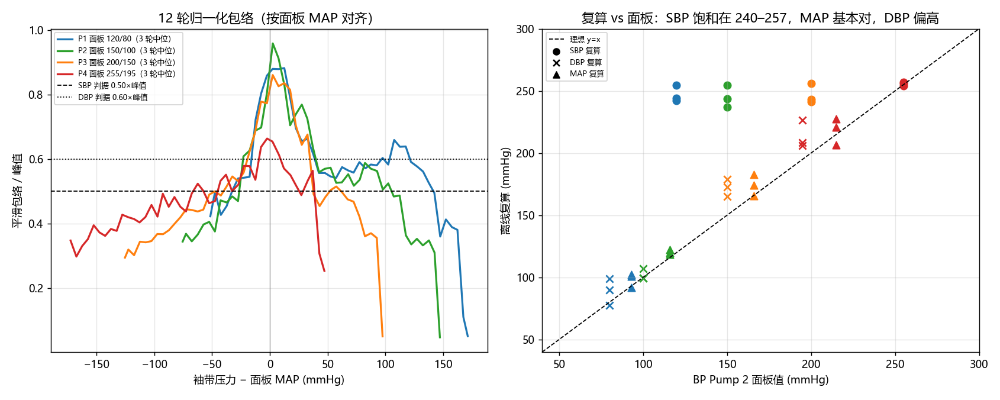

# 2026-11-06 预设矩阵采集报告（4 预设 × 3 轮）

## 1. 结论摘要

- 12 轮全部成功导出并通过离线回放校验：**dt 恒为 25.0 ms、无 >40 ms 缺口、设备内算法输出与生产 C 回放逐位一致**（`max_smooth_abs_error_v = 0.0`）。
- **MAP 这一量在这套台架上可用**：平滑包络峰落在面板 MAP 的 −8.7…+16.7 mmHg 内，脉搏最强压力带每次都覆盖面板 MAP；用强带法测出的心搏周期 **12 轮全部 0.750 s = 80.0 BPM**，与面板设定完全一致。
- **按比例的 SBP 判据不可用**：面板 SBP 从 120 变到 255，离线复算始终落在 **236.8–256.8**，与面板值几乎无关（图右）。这是台架气室柔度特性造成的包络上侧不衰减，不是算法 bug（见 §5）。
- **DBP 偏高且随压力增大而恶化**：P1 −2.5…+19.2、P2 −0.7…+7.0、P3 +14.9…+28.9、P4 +10.9…+31.6。
- **设备的 valid 比 invalid 更危险**：9 轮 `invalid`，3 轮 `valid` 但 SBP 错 100 mmHg 以上（§6）。
- 200–245 mmHg 段放气速率实测 **−1.669…−2.403 mmHg/s**（设定 1.8），偏快 24–34%；仅 P4 第一轮达到 −1.669。

## 2. 方法

- 固件 `PEAK_WINDOW_20261105`（`algo=PULSE_STEP_DEFLATE deflate=200ms_open1ms`），HEX sha256 `bb33a3a40471ba24b9e677c566b83ec19c4cf38393b687684f73d1a618418a96`。
- 校准 `cal write 82.326 -19.887`，读回 `slope=82.326mmHg/V intercept=-19.89mmHg zero=0.242V`。
- 台架接线与气路见 `data/raw/development_20261101/development_schematic_20261106.png`（sha256 `54b0370589f063eb24305391e89771b44f5dc846092850d4451764b6b1db5127`），**全程非人体**。
- 每轮流程：`vent → seal → 封阀零点 ≤0.9 mmHg → pins → cal → fault → profile peak → target 275 → start → 放气 275→≈15 → 等待 [BP] → 收尾 vent→seal 封阀零点 → capture export`。
- 宿主预先做 `vent → seal` 净气再取基线（`pre_capture_purge`），避免上一轮残气把基线抬过 1.2 mmHg。
- BP Pump 2 只注入脉搏容积，静压与放气由 MCU 控制；面板 `START` 后 BP Pump 2 在检测到外部压力时自动注入，一轮结束后自行停住并可重新武装。

## 3. 12 轮结果

| 预设 | run | n | dt(ms) | 200–245 斜率 | 包络峰 mV @mmHg | 平滑峰 @mmHg | MAP 复算 | SBP 复算 | DBP 复算 | BPM | 设备结果 |
|---|---|---|---|---|---|---|---|---|---|---|---|
| P1 120/80 | 142446 | 3451 | 25.0 | −2.221 | 35.225 @99.1 | 11.92 @102.5 | 102.5 | 242.3 | 77.5 | 80.0 | valid 232/72 |
| P1 | 143250 | 3395 | 25.0 | −2.253 | 38.956 @99.0 | 12.684 @100.8 | 100.8 | 254.8 | 99.2 | 80.0 | invalid |
| P1 | 143637 | 3353 | 25.0 | −2.261 | 30.042 @91.2 | 12.559 @92.0 | 92.0 | 244.3 | 90.0 | 80.0 | valid 234/84 |
| P2 150/100 | 144148 | 3291 | 25.0 | −2.309 | 39.407 @133.7 | 13.331 @118.4 | 118.4 | 254.4 | 107.0 | 80.0 | invalid |
| P2 | 144500 | 3393 | 25.0 | −2.129 | 30.084 @128.2 | 12.489 @119.7 | 119.7 | 236.8 | 99.5 | 80.0 | valid 233/84 |
| P2 | 144826 | 3361 | 25.0 | −2.177 | 30.188 @116.1 | 12.748 @122.1 | 122.1 | 243.4 | 99.3 | 80.0 | invalid |
| P3 200/150 | 145455 | 3337 | 25.0 | −2.197 | 35.702 @164.5 | 13.901 @165.4 | 165.4 | 241.3 | 164.9 | 80.0 | invalid |
| P3 | 145808 | 3315 | 25.0 | −2.292 | 39.903 @173.0 | 14.706 @174.2 | 174.2 | 243.2 | 172.8 | 77.4 | invalid |
| P3 | 150121 | 3241 | 25.0 | −2.403 | 38.218 @194.3 | 13.124 @182.7 | 182.7 | 256.0 | 178.9 | 80.0 | invalid |
| P4 255/195 | 133524 | 3929 | 25.0 | −1.669 | 33.630 @235.0 | 15.557 @206.3 | 206.3 | 256.2 | 205.9 | 80.0 | invalid |
| P4 | 135004 | 3731 | 25.0 | −1.904 | 35.666 @215.5 | 14.766 @227.4 | 227.4 | 254.0 | 226.6 | 80.0 | invalid |
| P4 | 135527 | 3497 | 25.0 | −2.168 | 30.826 @207.9 | 11.288 @220.9 | 220.9 | 256.8 | 208.4 | 80.0 | invalid |

（run 名为 `standard<sbp>_<dbp>_target275_peakwindow_20261106-<HHMMSS>`；全部位于 `data/raw/development_20261101/`，导出文件 `.export.ndjson` 的 SHA256 记在各轮 `.metadata.json` 的 `export_sha256`。）



左：按面板 MAP 对齐后的归一化平滑包络（每预设 3 轮取同一压力箱的中位数）。右：离线复算 vs 面板值。

## 4. 采样与放气质量

- 12 轮 dt 全为 25.0 ms（40 Hz），`gaps_gt40ms = 0`，压力覆盖 263.9–266.6 → 14.6–15.0 mmHg，每轮 3241–3929 点。
- 放气：200–245 mmHg 设定 1.8 mmHg/s，实测 −1.669…−2.403；P4 三轮是唯一一段真正接近设定的（−1.669/−1.904/−2.168），其余预设该段都跑到 −2.2 以上。原因是该段在 `profile peak` 下走 1.8 目标，而 PWM 闭环（200 ms 周期、最大导通 90 ms）在下限附近易过冲。
- 脉搏覆盖：绝大多数轮次全程可见；低于阈值（0.7–3.2 Hz 带通 rms < 1.0）的窗口只出现在 15–47 mmHg 的尾段，属包络本应衰减的区段，不是断档。

## 5. 为什么 SBP 复算饱和

固件（及离线复刻）用 `s_env_smooth >= 0.50 × max_env` 从上往下找 SBP。归一化包络（图左）显示：峰值在 MAP 处很尖，但 MAP 以上 20–150 mmHg 存在一条 **0.5–0.65 的平台**，0.50 阈值在面板 SBP +120 mmHg 处仍被穿过，于是 SBP 总是落在放气起点附近（240–257）。

物理成因：BP Pump 2 在 External Cuff 模式按固定活塞行程注入容积，压力摆动 ΔP ≈ ΔV / C(P)，而刚性硬芯 + 气室在高压段柔度下降，脉动幅度不随外压升高而衰减；人体肱动脉在袖带压高于 SBP 时容积脉动趋于零，两者形状不同。因此**示波法比例判据不能从人体移植到本台架**，这既是本数据集必须记录的边界，也是后续发布时的明确 limitations。

DBP 用 0.60 阈值向下找，落在平台下沿，因此系统性偏高；面板 DBP 越高，平台越靠上，误差越大。

## 6. 设备内血压结果的陷阱

- 9 轮 `[BP] calculation failed`，原因是 MAP 搜索窗被写死为 80…100 mmHg（`bp_algorithm.c:534-541`），只有 P1（真值 93）落进窗内。
- 3 轮 `valid`：P1 142446 → 232/72、P1 143637 → 234/84、P2 144500 → 233/84。面板分别是 120/80、120/80、150/100。**输出 `valid` 但 SBP 错 82–114 mmHg**，比 `failed` 更危险，发布数据时不能把 `valid` 当作可信标记。
- 曲线 `sbp > 250` 的作废判据（`bp_algorithm.c:482`）也说明固件本身默认 SBP 上限 250，与台架复算的 236–257 只差几 mmHg，属于同一饱和现象的两个表现。

## 7. 心搏频率核验

用「滑动 1 s 峰峰值最大处 ±15 mmHg」作为分析带，`find_peaks` 取中位周期：

| 预设 | 分析带 (mmHg) | 周期 (s) | BPM |
|---|---|---|---|
| P1（3 轮） | 84–120 | 0.750 | 80.0 |
| P2（3 轮） | 103–137 | 0.750 | 80.0 |
| P3（3 轮） | 150–195 | 0.750 / 0.775 / 0.750 | 80.0 / 77.4 / 80.0 |
| P4（3 轮） | 195–237 | 0.750 | 80.0 |

整轮不分段地取包络峰会得到 50–93 BPM 的假结果（低压尾段的噪声峰把中位周期带偏），**不能用**。这条经验已写进 `tmp/omniprobe/beat_rate_20261106.py`。

## 8. 数据边界与缺项

| 项 | 状态 | 说明 |
|---|---|---|
| 独立同步动态压力参考 | 缺 | 面板与 MCU 估压共用同一物理节点，不构成独立参考；需要 BP Pump 2 的 RS-232 输出才能补 |
| 面板照片 | 缺 | `panel_evidence_path = null`；面板设置由操作员口述转录，手册预设表不作为本轮证据 |
| 袖带容积 | 缺 | 未做灌水法测量 |
| 逐轮漏气率 | 缺 | 仅在 2026-11-01 测过一次（136–142 mmHg 起 7–8 mmHg/min） |
| 阀2 通电偏移 | 已记录 | vent 态读数被线圈抬高 +3.94 mmHg（+278 counts），收尾判据必须用封阀零点 |
| 零点漂移 | 已量化 | 封阀零点在 0.5–1.5 mmHg 之间游走；每轮开跑前净气可回到 ≤0.9 |

## 9. 复现

```powershell
# 单轮（面板切好预设后）
python tmp\bp_standard255_195_target275_peakwindow_20261105.py --panel-preset 3 --target-mmhg 275 `
  --confirm-nonhuman-fixture --confirm-current-panel --panel-pulse-volume-cc 0.60 --accept-rx-errors 1261
# 三连轮
python tmp\run_matrix_20261106.py 3 3 275
# 离线复算（禁止覆盖已存在的 CSV/report）
python tmp\omniprobe\analyze_export.py "data/raw/development_20261101/<run>.export.ndjson" --panel-sbp 200 --panel-dbp 150 --panel-map 166
python tmp\omniprobe\beat_rate_20261106.py "<run>.csv"
```

## 10. 结论

这 12 轮构成一套**采样完整、逐位可复现、设定点已知、心搏已知**的非人体示波法压力波形数据；它足以支撑「袖带压力波形 + 包络形状 + 台架特性」的数据论文叙事，也足以暴露比例判据在刚性台架上的失效。它**不能**用来宣称血压测量准确度，也不能替代独立动态参考。
